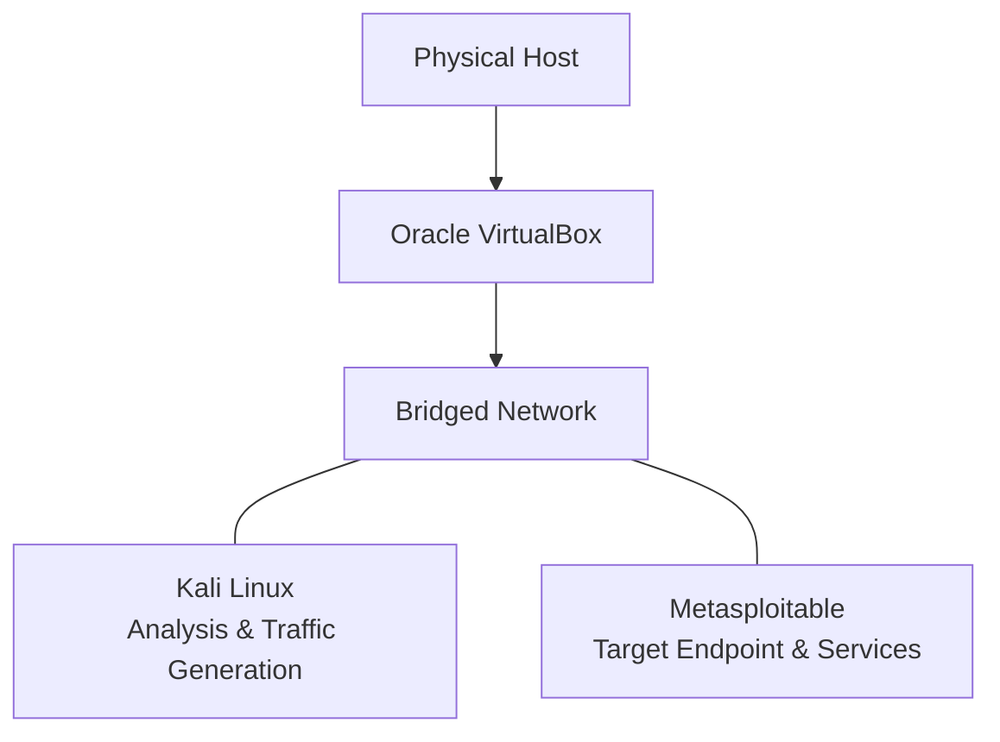

# Laboratory Architecture

## 1. Overview

The Linux & Network Security Lab uses a virtualized environment to reproduce, observe, and analyze computer networking concepts through controlled experiments.

The initial architecture consists of two virtual machines running in Oracle VirtualBox. Each machine has a distinct role in the laboratory.

The infrastructure is intentionally kept simple to minimize unnecessary complexity and allow experiments to focus on network behavior rather than environment configuration.

## 2. Infrastructure

### 2.1 Virtual Machines

| Machine | Operating System | Role |
|---|---|---|
| Kali Linux | Kali Linux | Network analysis, traffic generation, and experimentation |
| Metasploitable | Metasploitable | Target endpoint and network service provider |

### 2.2 Virtualization Platform

- **Hypervisor:** Oracle VirtualBox
- **Network Adapter Mode:** Bridged Adapter
- **Connectivity:** Verified through successful ICMP communication between both virtual machines.

### 2.3 Machine Responsibilities

**Kali Linux**

The primary experimental workstation.

Responsibilities include:

- Generating network traffic.
- Capturing and inspecting packets.
- Executing network analysis tools.
- Running auxiliary scripts.
- Collecting and organizing experimental evidence.

**Metasploitable**

The secondary network endpoint.

Responsibilities include:

- Receiving network traffic generated by Kali.
- Providing network services for communication experiments.
- Responding to protocol requests.
- Acting as a controlled endpoint for observing network interactions.

## 3. Network Topology

The initial topology consists of two virtual machines connected through a bridged network.

Both virtual machines can communicate with each other, and initial connectivity has been verified using ICMP ping.

The bridged configuration allows the virtual machines to participate in the network connected to the physical host.

## 4. Network Communication

The laboratory uses direct communication between Kali Linux and Metasploitable to reproduce networking scenarios.

Depending on the experiment, communication may involve:

- ARP address resolution.
- ICMP messages.
- TCP connections.
- UDP datagrams.
- Application-layer protocols.
- Multiple simultaneous communication flows.

The actual network addresses, MAC addresses, interfaces, and routing information will be recorded when relevant to individual experiments.

## 5. Analysis and Evidence Collection

Network traffic will be captured and analyzed using tools selected according to each experiment's requirements.

Potential tools include:

- Wireshark for graphical packet inspection.
- tcpdump for command-line packet capture.
- Scapy for packet construction and protocol experimentation.
- Python and Bash for automation and supporting scripts.

Captures will be stored in the corresponding experiment directory under `captures/`.

Additional evidence, including terminal outputs and screenshots, will be organized alongside the experiment documentation.

## 6. Architectural Decisions

### Decision 001: Use Existing Virtual Machines

**Decision:** Reuse the existing Kali Linux and Metasploitable virtual machines.

**Rationale:** Both machines are already available and have verified network connectivity. Creating additional endpoints is unnecessary for the initial experiments.

### Decision 002: Use Bridged Networking

**Decision:** Keep the existing Bridged Adapter configuration.

**Rationale:** The current configuration provides working connectivity between both machines and preserves the existing network and Internet access behavior.

**Considerations:** Metasploitable intentionally exposes vulnerable services. Experiments must remain controlled, and unnecessary exposure of its services to external networks must be avoided.

### Decision 003: Select Tools Per Experiment

**Decision:** Do not enforce a fixed toolset.

**Rationale:** Each experiment should use the tools that best demonstrate the networking concept under investigation.

## 7. Future Considerations

The architecture may be extended when an experiment requires capabilities not provided by the initial environment.

Potential extensions include:

- Additional virtual machines.
- Isolated virtual networks.
- Additional network interfaces.
- Multiple communication endpoints.
- Custom traffic generators and network simulation tools.

Any infrastructure change should have a clearly identified experimental purpose.

## 8. Current Status

| Component | Status |
|---|---|
| Kali Linux VM | Available |
| Metasploitable VM | Available |
| VirtualBox | Available |
| Bridged networking | Configured |
| Inter-VM connectivity | Verified |
| Packet capture environment | To be validated during the first experiment |

The initial laboratory infrastructure is ready for the first practical experiment.